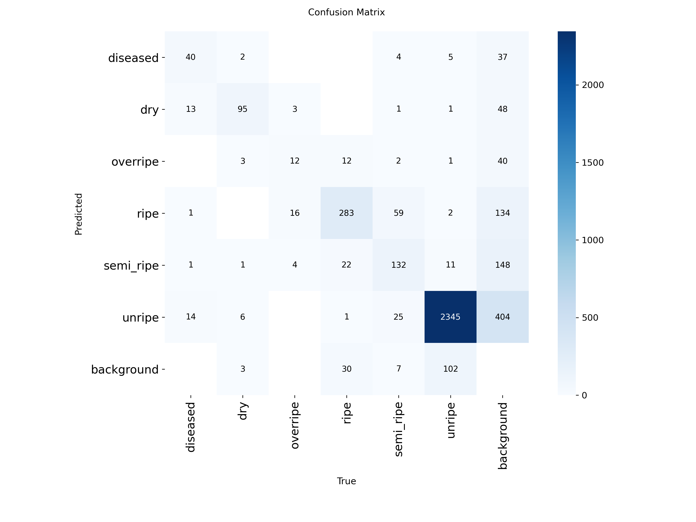

# ☕ BeensMe AI — Deteksi Tingkat Kematangan Biji Kopi

Aplikasi web berbasis **YOLOv8** dan **ONNX Runtime Web** untuk mendeteksi serta mengklasifikasikan tingkat kematangan biji kopi secara otomatis langsung di browser (*client-side inference*).

## Fitur Utama
- **Deteksi Objek Multi-Kelas:** Mendeteksi 6 kategori kondisi biji kopi (`diseased`, `dry`, `overripe`, `ripe`, `semi_ripe`, dan `unripe`) secara langsung tanpa server backend.
- **Pengaturan Threshold Interaktif:** Pengguna dapat menyesuaikan batas keyakinan (*confidence threshold*) dan melihat rekapitulasi jumlah biji kopi per kategori.

## Evaluasi Model (Confusion Matrix)

## Teknologi yang Digunakan
- **Model AI:** YOLOv8 (format `.onnx`)
- **Frontend:** HTML5, CSS3, Vanilla JavaScript, ONNX Runtime Web